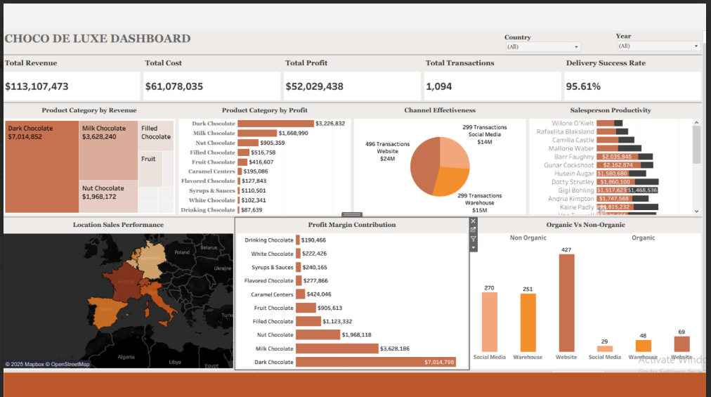

# 🍫 Chocolate Sales Performance Analysis

### Tableau Dashboard | Sales Analytics | Product Profitability | Business Intelligence

## 📌 Project Overview

This project analyzes Choco de Luxe's sales performance to identify growth opportunities, evaluate profitability, and support data-driven business decisions.

The analysis explores regional sales performance, channel effectiveness, salesperson productivity, product profitability, organic versus non-organic demand, and profit margins.

## 📊 Tableau Dashboard

## 📈 Key Performance Insights

### 🌍 Regional Sales Performance
- Italy, Spain, and the Netherlands lead in revenue and profit.
- Spain, France, and Germany demonstrate strong product delivery success.
- Underperforming regions present opportunities to improve sales and logistics efficiency.

### 🛒 Channel Effectiveness
- The website channel contributes the highest revenue and profit.
- The warehouse channel generates substantial sales but at lower margins.
- Social media supports customer engagement and provides opportunities for targeted campaigns.

### 🍫 Product Profitability
- Overall profit margin is approximately **46%**.
- Dark, Milk, and Nut Chocolate are leading contributors to profitability.
- Dark Chocolate generates approximately **$7.01M in revenue** and **$3.23M in profit**.
- Lower-performing product categories present opportunities for repositioning and targeted marketing.

### 🌱 Organic vs. Non-Organic Demand
- Organic products account for a smaller share of revenue but offer potential for customer loyalty and product differentiation.
- Non-organic products dominate sales across the website, warehouse, and social media channels.
- Digital marketing and premium product storytelling can help grow organic product sales.

### 👥 Salesperson Productivity
- Several salespeople exceeded the **$100,000 sales target**.
- Top performers achieved more than **250% target attainment**.
- Salespeople below 50% attainment may benefit from targeted coaching and territory reviews.

## 💡 Business Recommendations

- **Protect top-performing products:** Maintain inventory availability for Dark, Milk, and Nut Chocolate.
- **Improve the website experience:** Simplify product navigation and introduce personalized cross-selling.
- **Optimize sales channels:** Improve warehouse cost efficiency and expand targeted social media campaigns.
- **Strengthen regional performance:** Focus on successful markets and test growth strategies in underperforming regions.
- **Expand premium offerings:** Introduce curated bundles, seasonal products, and stronger organic product storytelling.
- **Improve salesperson performance:** Use performance tracking, coaching, and incentive programs.

## 🛠️ Tools & Skills

- **Tableau** — Dashboard development and data visualization
- **Sales Analytics** — Revenue, profit, and margin analysis
- **Business Intelligence** — KPI analysis and performance monitoring
- **Data Analysis** — Regional, product, channel, and salesperson comparisons
- **Business Strategy** — Business recommendations and growth planning

## 🎯 Business Value

The project translates sales data into actionable insights to help identify profitable products, evaluate channel performance, improve sales productivity, and guide marketing and growth strategies.

## 📁 Project Files

- `choco.png` — Tableau dashboard screenshot
- `CHOCO DE LUXE PRESENTATION.pptm` — Full project presentation, including the analysis and recommendations

## 👩‍💻 Project Author

**Chinelo Akinleye**

Data Analytics | Business Intelligence | Tableau | Power BI

[GitHub](https://github.com/chineloakinleye) | [LinkedIn](https://www.linkedin.com/in/chinelo-akinleye-632366398/)
